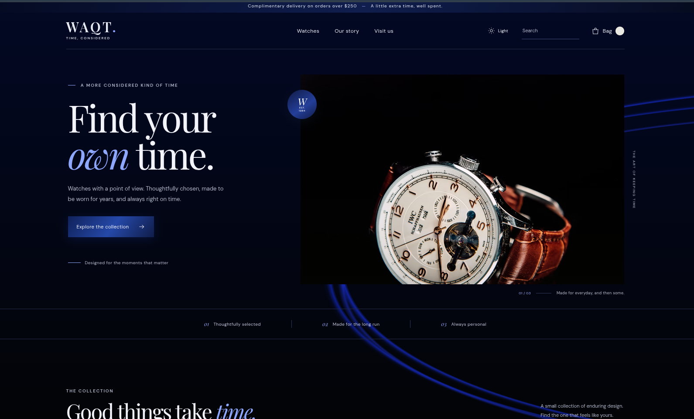

# MSTIA Challenge 08 — WAQT (Mr. Karim’s E-Commerce Hub)

A modern, responsive e-commerce storefront built with React and Vite. WAQT provides a clean shopping interface with dynamic product loading, product search, category filtering, and an interactive shopping cart.<br>
**Category:** Web Development & E-Commerce<br> 
**SiteURL:** [Visit the site](https://waqt-watch.vercel.app/)

## Overview

WAQT is a branded watch storefront designed to provide customers with a simple and convenient way to browse timepieces.y



The project focuses on a responsive watch storefront where users can explore branded watches, search by name, filter by watch style, and manage items in a shopping cart.

The frontend retrieves product information from a public mock API and provides local sample products as a fallback when the API is unavailable.

---

## Features

### Storefront
- Responsive e-commerce interface.
- Modern navigation and hero section.
- Product catalog with product images, names, categories, and prices.
- Dynamic product loading.

### Product Discovery
- Search products by name.
- Filter products by category.
- Browse products through organized product cards.

### Shopping Cart
- Add products to the cart.
- Increase or decrease product quantities.
- Remove individual products.
- Automatically calculate the cart total.

### Responsive Design
- Desktop, tablet, and mobile support.
- Responsive navigation and shopping interface.
- Clean layout and consistent visual styling.

### API Integration
- Fetches products from Fake Store API.
- Uses local sample products as fallback data.
- Separates product-fetching logic from UI components for future backend integration.

---

## Technology Stack

| Technology | Purpose |
|---|---|
| React | Frontend user interface |
| Vite | Development server and build tool |
| JavaScript | Application logic |
| CSS | Styling and responsive layout |
| Fake Store API | External mock product data |
| Node.js & npm | Development environment and package management |

---

## Project Structure

```text
MSTI_Arena-ASL-08/
│
├── backend/                 # Backend implementation (in progress)
│
├── src/
│   ├── services/
│   │   └── products.js      # Product API and fallback data
│   │
│   ├── components/         # Reusable UI components
│   ├── assets/              # Static assets
│   ├── App.jsx              # Main application
│   └── main.jsx             # Application entry point
│
├── tests/                   # Frontend tests
│
├── index.html
├── package.json
├── package-lock.json
├── vite.config.js
├── .gitignore
└── README.md
```

---

## Installation & Setup

### Prerequisites

- Node.js
- npm
- Git

### 1. Clone the repository

```bash
git clone https://github.com/aryanaritro/MSTI_Arena-ASL-08.git
```

### 2. Enter the project directory

```bash
cd MSTI_Arena-ASL-08
```

### 3. Install dependencies

```bash
npm install
```

### 4. Start the development server

```bash
npm run dev
```

Open the local URL displayed in the terminal to access WAQT.

---

## Product Data Source

WAQT currently checks the Fake Store API:

`https://fakestoreapi.com/products`

Only products identified as watches are displayed from the API. Fake Store API currently contains general merchandise rather than a watch catalog, so its clothing, jewelry, electronics, and accessories are excluded. When the API has no watch products (or is unavailable), the site displays a local branded watch collection instead.

The product service is kept separate from the interface to make future integration with the project's own watch catalog easier.

---

## Backend Development Status

The backend implementation is part of the project's planned architecture.

The intended backend technology stack includes:

- Node.js
- Express.js
- MongoDB
- Mongoose
- bcryptjs

The backend development and database integration are not yet complete. The current storefront operates using mock API data and local fallback products.

User registration, automated welcome emails, and full database-backed product management are not yet presented as completed features.

---

## Testing & Verification

The following checks have been completed:

| Test | Result |
|---|---|
| Frontend test suite | PASS |
| Production build | PASS |
| Product loading | PASS |
| Search functionality | PASS |
| Category filtering | PASS |
| Cart quantity controls | PASS |
| Cart item removal | PASS |
| Cart total calculation | PASS |
| Responsive browser checks | PASS |

### Dependency Security

The production dependency audit reports zero vulnerabilities.

The full npm audit still reports four high-severity findings associated with the development dependency chain (`picomatch`, `fdir`, `tinyglobby`, and Vite). A verified upstream fix is not currently available.

---

## Future Development

Planned improvements include:

- Complete MongoDB database integration.
- Customer registration and authentication.
- Database-backed product management.
- Automated welcome emails using Nodemailer.
- Backend API integration with the storefront.
- Additional e-commerce functionality.

---

## Project Information

**Project Name:** WAQT — Mr. Karim’s E-Commerce Hub  
**Competition:** ASL National Arena  
**Challenge:** #08 — E-Commerce Hub  
**GitHub Account:** [aryanaritro](https://github.com/aryanaritro)  
**Repository:** [MSTI_Arena-ASL-08](https://github.com/aryanaritro/MSTI_Arena-ASL-08)

---

## License

This project is developed for the ASL National Arena competition.
